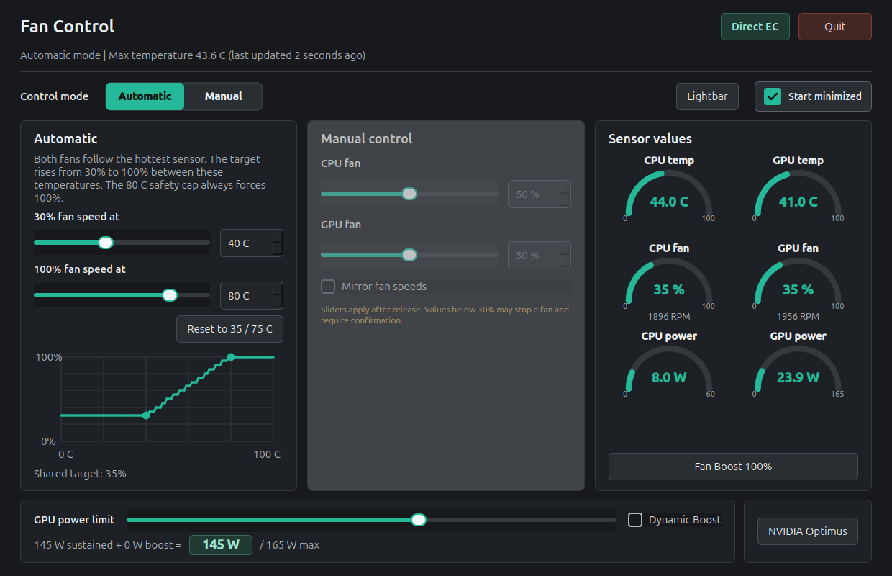

# Using the App

The same window runs on Windows and Ubuntu. Differences between the two are noted where they matter.



## The Window at a Glance

- **Status line** under the title: the current mode and the temperature driving the fans, with the time since the last update. The age is a display-only timer; it never triggers a sensor read.
- **Control method badge** at the top right: **Direct EC** or **OEM MQTT** (Windows only uses OEM MQTT while the OEM `GCUBridge` broker runs; see the [Windows guide](windows.md#how-fan-control-works-on-windows)).
- **Exit** (Windows) or **Quit** (Ubuntu): see [Closing and exiting](#closing-and-exiting).
- **Control mode**: **Automatic** or **Manual**. The inactive section is disabled and dimmed.
- **Sensor values**: gauges and the **Fan Boost 100%** button. Available in both modes.
- **GPU power limit** with **Dynamic Boost**, and the **Lightbar** and **NVIDIA Optimus** windows.

## Automatic Mode

Both fans follow the hotter of the CPU and GPU temperatures and get the same target. The two temperature points accept values from 0 to 100 C:

| Default temperature | Fan duty |
| ---: | ---: |
| 35 C or below | 30% |
| 75 C or above | 100% |

Between the two points the duty rises linearly and is rounded to the nearest 5%. **Reset to 35 / 75 C** restores the defaults. Automatic mode never requests less than 30%. The fixed 80 C safety cap always forces 100%, even when the upper point is set above 80 C. The chart shows the resulting curve and **Shared target** shows the current duty.

Automatic is the startup mode. Selecting it starts an immediate cycle followed by non-overlapping 15-second cycles. If either temperature is missing or implausible, the cycle writes nothing; see the [safety model](safety.md).

## Manual Mode

Manual mode sets the CPU and GPU fans separately. Turn on **Mirror fan speeds** to move both together. Values are rounded to 5% steps. Any value below 30% for either fan asks for confirmation, because a low duty may stop a fan.

Manual mode holds the selected targets even when temperatures are high; it does not scale them for heat. Selecting Manual stops future automatic cycles. Switching between **Automatic** and **Manual** asks for confirmation; canceling keeps the current mode.

## Sliders

Every slider (CPU/GPU fan duties, the automatic temperature points, GPU power, and the lightbar colors) previews its value while you drag it and sends nothing until you release it. Pressing a slider cancels a pending update for its group, so an earlier keyboard or wheel change cannot apply in the middle of a drag. Keyboard and mouse-wheel changes apply after a short pause, and typed values apply when you finish editing. The low-duty confirmation still applies.

## Sensor Values and Fan Boost

The panel shows CPU and GPU temperature gauges and the fan duty of each fan.

- **Ubuntu**: the fan gauges also show both fan speeds in RPM, with CPU and GPU power draw underneath. CPU package power comes from RAPL, GPU power from the NVIDIA driver.
- **Windows**: GPU power comes from a separate NVIDIA query and CPU package power from read-only AMD energy counters through PawnIO. CPU watts appear after the second sample and average the refresh interval. Fan RPM is shown in Direct EC mode. An amber warning icon beside the control method badge appears when NVIDIA reports software thermal throttling; its tooltip explains that GPU or memory thermal limits may be reducing performance. It refreshes with the sensor telemetry, about every 10 seconds, and clears when the flag is inactive or unavailable.

Missing power, RPM or throttling values only leave that detail empty. They never invalidate temperature readings or change fan control.

**Fan Boost 100%** is the OEM's own full-speed mode. Use it immediately if temperatures rise unexpectedly. While the sensor watchdog holds Boost because no sensor works, it cannot be turned off.

On Windows the panel also has a **Start/Stop GCUBridge** button, which switches between OEM MQTT and Direct EC control after a confirmation.

## GPU Power Limit and Dynamic Boost

The **GPU power limit** slider raises the sustained NVIDIA power limit (cTGP) from the 115 W base up to 165 W in 5 W steps, capped by the GPU's VBIOS maximum. **Dynamic Boost** lets the GPU borrow up to 25 W more while the CPU is lightly loaded. NVIDIA's effective limit is

```text
min(115 W + offset + 25 W boost, 165 W)
```

so a large offset leaves no room for boost. This is the same model TUXEDO Control Center shows.

The readout under the slider is `sustained + boost = NVIDIA limit / maximum`, with the limit NVIDIA actually enforces highlighted. With Dynamic Boost on, the boost term reads `0 of 25 W` while the GPU is idle: NVIDIA adds the boost only under GPU load. If the enforced limit falls outside the requested range, or `nvidia-powerd` is not running, the readout turns into a warning.

Until you choose a setting, the app only reads these values. After that it remembers your choice and restores it after drift, restart, and resume.

- **Ubuntu**: NVIDIA applies these settings only while its `nvidia-powerd` daemon runs. The installer sets it up; the GUI warns when it is not running.
- **Windows**: available only in Direct EC mode on the exact validated laptop. See [GPU power on Windows](windows.md#gpu-power-limit-and-lightbar-on-windows).

## Lightbar

**Lightbar** opens a window to set the front lightbar to a solid color (red, green and blue sliders, 0-36 each), the firmware's rainbow animation, or off. Click an option to switch to it; the color sliders are grayed out unless Color is selected. Changes apply immediately.

The app remembers the mode and the last color, restores them after boot and resume, and rewrites them every 15 minutes in case the lightbar forgets them. Until you pick a mode it leaves the lightbar alone (rainbow after power-on). On Windows the lightbar is available only in Direct EC mode, while `GCUBridge` is stopped.

## NVIDIA Optimus (Experimental)

**NVIDIA Optimus**, to the right of the GPU power limit, opens a window to choose **Hybrid/Optimus** or **NVIDIA dGPU** for the next boot.

1. Stop OEM Control Center/`GCUBridge` (Windows) or `tccd` (Ubuntu). The current setting stays visible while the OEM service runs, but it cannot be changed.
2. Choose a mode and save. Confirm the mode.
3. Confirm the experimental risk by typing exactly **YES DO IT**. Enter saves only once the phrase is typed; Esc and Cancel cancel.
4. On Ubuntu, enter the administrator password (asked every time the mode actually changes).
5. Reboot yourself. The app never reboots, and the saved mode may differ from the current display route until you do.

Canceling any step writes nothing. Opening the window, starting the app and its maintenance checks never write this setting. A full backup is saved before each write (`%LOCALAPPDATA%\StellarisFanControl\mux-backups` on Windows, `/var/lib/stellaris-fan-control/mux-backups` on Ubuntu). This feature has not been fully validated; the firmware details and limits are in the [safety model](safety.md#nvidia-optimus-firmware-setting) and the [MUX analysis](../cc_analysis/nvidia-optimus.md).

## Settings and Startup

Automatic mode always starts on launch; Manual values are remembered for the next time Manual is selected. A missing or malformed settings file falls back to the 35/75 C points, 50% Manual targets, mirroring off, and **Start minimized** on.

| Setting | Windows | Ubuntu |
| --- | --- | --- |
| Automatic points | `StellarisFanControl.json` beside the executable | `/var/lib/stellaris-fan-control/settings.json` (service) |
| Manual targets, mirror, Start minimized | same file | `~/.config/stellaris-fan-control/StellarisFanControl.json` |
| GPU power limit, Dynamic Boost | `%LOCALAPPDATA%\StellarisFanControl\gpu-power.json` | service `settings.json` |
| Lightbar | `%LOCALAPPDATA%\StellarisFanControl\lightbar.json` | service `settings.json` |

**Start minimized**, beside the control mode selector, starts the app in the system tray on the next launches, including sign-in startup. Changing it does not hide the current window. If no system tray is available, the window starts minimized on the taskbar. Clicking the tray icon, its **Show Fan Control** action, or launching the app again restores the window. Only one window can run; a second launch activates the existing one. The tray's **About** action opens this project's GitHub page.

## Closing and Exiting

Closing the window hides it in the tray; fan control keeps running.

The tray icon shows the hotter of the CPU and GPU: its normal look up to 70 C, yellow above 70 C, and red above 85 C. Red blinks once a second and shows one desktop notification; the next notification comes only after the reading has fallen back to 70 C or below. The tray menu's **High temperature notifications** item, on by default, turns these notifications off; the icon still turns red and blinks. Hovering over the icon shows the hottest reading.

- **Windows**: the app is the controller. **Exit** (button or tray menu) asks for confirmation, then stops Automatic mode, turns Fan Boost off, writes 100% to both fans, and exits only if that write succeeds. Shutdown, restart and sign-out also write 100% first; see [the Windows guide](windows.md#shutdown-and-exit).
- **Ubuntu**: the root service is the controller and keeps running without the GUI. **Quit** asks for confirmation and closes only the GUI. Stopping the service, including shutdown and reboot, writes 100% to both fans.
